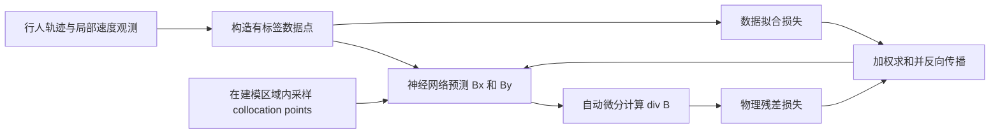

# 论文解读：SocialNav-FTI 的社会场与 PINN

创建日期：2026-10-20

> 原文献：[[SocialNav-FTI_Field-Theory-Inspired_Social-aware_Navigation_Framework_based_on_Human_Behavior_and_Social_Norms.pdf|点击打开 PDF]]
> Lu, Zhong, Ye, Chen, Sheng, Liu. *SocialNav-FTI: Field-Theory-Inspired Social-aware Navigation Framework based on Human Behavior and Social Norms.* IEEE/RSJ IROS 2024, pp. 4808-4815. DOI: 10.1109/IROS58592.2024.10802269.

## 0. 一句话总结

SocialNav-FTI 把人流中“大多数人在这个位置更倾向于往哪里走”压缩成一个连续的速度向量场，并用 PINN 同时拟合观测数据和“无源无汇”的物理约束；机器人做局部导航时，除了追求目标和避免碰撞，还要让自己的运动尽可能符合这个速度场。因此，**社会规范不是写成一条条人工规则，而是通过人群运动的高概率空间模式间接进入 DRL 的奖励函数**。

## 1. “场”在这里到底是什么

### 1.1 从个体轨迹到连续向量场

对每个人来说，速度是一个随时间变化的二维向量。把同一区域内、相近时刻的大量行人速度做空间统计，就可以把离散的个体速度组织成连续场：

$$
\mathbf B(\mathbf r,t)
=
\begin{bmatrix}
B_x(x,y,t)\\
B_y(x,y,t)
\end{bmatrix},
\qquad
\mathbf r=(x,y).
$$

- 输入是空间位置 $\mathbf r$ 和时间 $t$；
- 输出是该位置对应的“典型人流速度”；
- 箭头长度表示典型速度大小，箭头方向表示多数人的运动倾向；
- 场线可以看成人群最自然、最常见的运动轨迹；
- 即使机器人当前位置没有行人，也可以查询该位置的场值。

论文把社会规范解释为一种高概率的共同行为模式。例如，在某个走廊或出口附近，多数人长期形成靠右通行、绕开拥挤区域或沿某一方向汇流的习惯。这个习惯会在速度场中表现为稳定的方向和流线，因此场可以作为社会规范的一种弱代理表示。

这里的“社会规范”是统计意义上的行为倾向，不等于法律或伦理规则。它描述的是“多数人通常怎么走”，而不是“所有情况下都应当怎么走”。

![[图片库/SocialNav-场-从离散观测到连续场.png]]

> **读图：** 左图是不同行人留下的离散速度样本；中图把同一局部邻域内的样本汇总成一个典型速度；右图把所有位置的统计结果连成连续场。最关键的一点是：**场不是某一个人，也不是一条固定轨迹，而是定义在空间上的函数 $\mathbf B(\mathbf r,t)$。** 因此机器人可以查询“我现在这个位置，多数人会往哪里走”，即使脚下恰好没有行人。

### 1.2 场在导航中的三个作用

**第一，提供稠密的社会信号。**

关系图模型通常把机器人、行人当成节点，只描述谁和谁发生交互。速度场进一步把环境的空间语义和人流规律放进同一个表示中：某个位置不是孤立的点，而是有方向、有常见流量、有局部习惯的位置。

**第二，补足机器人的局部视野。**

机器人只能看到当前传感器范围内的行人，但场可以覆盖整个建模区域，并在没有直接观测的位置给出预测。这使机器人能在一定程度上“提前理解”前方人流倾向。

**第三，把社会规范转成可优化的奖励。**

论文把机器人实际速度 $\mathbf v_t$ 与所在位置的社会场速度 $\mathbf v_f^t$ 的差异作为社会规范奖励：

$$
r_t
=
r_g^t+r_c^t+r_\omega^t+r_n^t,
$$

$$
r_n^t
=
r_{\mathrm{field}}
\left(
\left\|\mathbf v_f^t-\mathbf v_t\right\|
\right).
$$

其中 $r_g$ 鼓励到达目标，$r_c$ 惩罚碰撞，$r_\omega$ 抑制过大的转向角速度，$r_n$ 约束机器人遵循人流模式。论文没有在正文中给出 $r_{\mathrm{field}}$ 的完整解析式，但它的作用是把“机器人与当地人流不一致”变成奖励惩罚。

若为了直观理解，把 $r_{\mathrm{field}}$ 取成负二次惩罚，则可以写成：

$$
r_n^t
\approx
-k
\left\|\mathbf B_\theta(\mathbf p_t)-\mathbf v_t\right\|_2^2.
$$

这只是帮助理解的形式，不是论文原文给出的唯一实现。场速度与机器人速度越接近，惩罚越小，机器人越倾向于沿着当地主流方向运动。

![[图片库/SocialNav-场-导航中的作用.png]]

> **读图：** 左侧强调场只提供“局部方向偏好”，同一个场可以容纳多条不同的可执行路线；右侧把奖励项画成两个速度向量。机器人速度与当地场速度接近时惩罚较小，方向背离时惩罚较大。具体路线仍需由目标、碰撞约束和动力学可行性共同决定。

> 注意：论文式 (6) 表达的是“实际速度与场速度的差异”，其自然解释是希望机器人对齐当地人流；但论文正文随后有一句“behave in the opposite direction of most pedestrians”。这与式 (6) 的方向解释存在歧义。复现时建议以官方代码为准，不要把这句话与公式同时生硬地解释成物理事实。论文给出的代码地址为 [SocialNav-FTI](https://github.com/SiyiLoo/SocialNav-FTI)。

### 1.3 为什么人流的散度可以为 0

论文在局部人群场景中假设行人不会突然凭空出现或消失，因此速度场近似无源、无汇：

$$
\nabla\cdot\mathbf B
=
\frac{\partial B_x}{\partial x}
+
\frac{\partial B_y}{\partial y}
=
0.
$$

“散度”可以理解为某一点是不是流的源或汇：

- $\nabla\cdot\mathbf B>0$：该点附近净向外发散，像有新的行人源；
- $\nabla\cdot\mathbf B<0$：该点附近净向内汇聚，像有行人的汇；
- $\nabla\cdot\mathbf B=0$：净流入等于净流出，流线不会在局部终结或凭空产生。

如果 $\mathbf B$ 是一个不可压缩流场，那么 Gauss 散度定理给出：

$$
\oint_{\partial\Omega}
\mathbf B\cdot\mathbf n\,\mathrm ds
=
\int_{\Omega}
\nabla\cdot\mathbf B\,\mathrm dA.
$$

当散度处处为 0 时，任意闭合边界上的净通量也为 0。论文在第 IV-B 节用方形区域的面积分和边界积分验证 $\phi_w\approx\phi_s$，从而支持这种场建模假设。

![[图片库/SocialNav-场-散度的三种形态.png]]

> **读图：** 源像“水龙头”，局部净向外发散，$\nabla\cdot\mathbf B>0$；汇像“排水口”，局部净向内汇聚，$\nabla\cdot\mathbf B<0$；第三种情况流入与流出平衡，因此 $\nabla\cdot\mathbf B=0$。PINN 惩罚第三种情况之外的不合理源汇，但这个等式在这里是建模约束，不是对真实人群的绝对物理保证。

不过要强调：**这是论文采用的宏观、局部建模假设，不是所有人群场景都严格服从的普遍物理定律。** 出入口、上下车、检测缺失和人群密度快速变化都可能产生源汇。更一般的行人质量守恒应当写成

$$
\frac{\partial\rho}{\partial t}
+
\nabla\cdot(\rho\mathbf B)
=
0,
$$

其中 $\rho$ 是人群密度。只有密度近似均匀且局部无源无汇时，才更容易退化为 $\nabla\cdot\mathbf B=0$。

## 2. PINN 在论文中如何预测社会场

### 2.1 普通神经网络为什么不够

普通监督学习只关心训练点：

$$
\mathbf B_\theta(\mathbf r)\approx\mathbf B_s(\mathbf r)
\quad
\text{for sampled pedestrian locations } \mathbf r.
$$

只要网络在观测点上拟合得好，数据损失就可以很小。但是，训练点之间的区域可能存在无穷多种插值方式，其中一些会产生不合理的局部源、汇或突然转向。仅靠稀疏数据无法判断哪种插值更符合人流规律。

PINN 的基本思想是：**让神经网络的输出不仅拟合数据，还要在未标注的空间点上满足已知的微分方程。**

### 2.2 论文的网络结构

论文的群体速度场预测网络接收位置 $(x,y)$，经过若干全连接层，输出速度场的两个分量 $(B_x,B_y)$。隐藏层使用 $\tanh$ 激活函数。网络同时被数据损失和物理损失约束。

![[图片库/SocialNav-FTI-PINN架构.png]]

图 2 展示了论文的 PINN 结构：左上是位置输入，右侧分别输出速度分量；蓝色支路计算与观测速度的预测损失，红色支路计算散度约束损失。

### 2.3 两个损失项

设观测点集合为 $\{\mathbf r_i^B\}_{i=1}^{N_B}$，观测到的场速度为 $\mathbf B_s(\mathbf r_i^B)$，则数据损失为

$$
\mathcal L_B
=
\frac{1}{N_B}
\sum_{i=1}^{N_B}
\left\|
\mathbf B_\theta(\mathbf r_i^B)
-
\mathbf B_s(\mathbf r_i^B)
\right\|_2^2.
$$

再在建模区域内采样一批 collocation points $\{\mathbf r_d^i\}_{i=1}^{N_f}$。这些点不需要速度标签，只用于检查网络输出是否满足物理方程。散度残差损失为

$$
\operatorname{div}\mathbf B_\theta(\mathbf r)
=
\frac{\partial B_{x,\theta}}{\partial x}
+
\frac{\partial B_{y,\theta}}{\partial y},
$$

$$
\mathcal L_{\nabla\cdot\mathbf B}
=
\frac{1}{N_f}
\sum_{i=1}^{N_f}
\left|
\nabla\cdot\mathbf B_\theta(\mathbf r_d^i)
\right|^2.
$$

总损失为

$$
\mathcal L
=
\mathcal L_B
+
\lambda\mathcal L_{\nabla\cdot\mathbf B}.
$$

论文用 TensorFlow 的自动微分计算 $\partial B_x/\partial x$ 和 $\partial B_y/\partial y$。训练超参数包括学习率 0.01、batch size 64；在预训练模型基础上继续训练 3000 轮后，预测速度场与真实场的 MSE 为 0.065。

### 2.4 自动微分在这里做了什么

神经网络 $\mathbf B_\theta(\mathbf r)$ 是一个可微函数。自动微分不需要手工推导整张网络对输入的解析导数，也不使用有限差分近似，而是沿计算图精确传播导数。

以简化的一维网络为例：

$$
z=wx+b,\qquad B_x=\sin z.
$$

则有

$$
\frac{\partial B_x}{\partial x}
=
\cos(z)\frac{\partial z}{\partial x}
=
w\cos(wx+b).
$$

PINN 把这种对输入的导数直接放进损失函数。于是优化器不仅调整网络去“拟合箭头长度”，还调整网络去“让相邻箭头之间平滑地满足平衡关系”。

### 2.5 PINN 的训练闭环

每一步可以概括为：

1. 从轨迹数据估计若干位置的典型速度，得到数据点；
2. 在环境中重新采样无标签 collocation points；
3. 网络对两类点都输出 $(B_x,B_y)$；
4. 对 collocation points 自动求导，计算散度；
5. 将数据误差平方和散度平方加权相加；
6. 反向传播更新网络参数；
7. 重新采样或继续训练，最后用留出数据和物理残差分别验证。

## 3. 一个具体例子：用物理约束补全稀疏人流场

下面是一个用于解释原理的合成例子，不是论文在某个具体地图上的原始实验。

假设机器人前方的无障碍区域为

$$
\Omega=[0,4]\times[0,3].
$$

区域内只有少量位置观测到平均人流速度，这些点像稀疏的箭头。一个合理的平滑人流场可以构造为

$$
\mathbf B_0(x,y)
=
\begin{bmatrix}
1+0.2\sin(\pi y)\\
0.1\cos(\pi x)
\end{bmatrix}.
$$

它表示人流整体向右，同时在不同纵向位置有轻微摆动。计算散度：

$$
\frac{\partial B_{0x}}{\partial x}
=
0,
\qquad
\frac{\partial B_{0y}}{\partial y}
=
0,
$$

所以

$$
\nabla\cdot\mathbf B_0=0.
$$

这是一个无源无汇的场。现在把少量观测箭头交给普通网络，它可能只在这些点附近拟合得很好，却在两个观测点之间生成不合理的局部收缩或爆发。PINN 在这个例子中会做两件事：

1. 在观测点附近让预测箭头接近测量箭头；
2. 在大量没有标签的网格点上要求 $\partial B_x/\partial x+\partial B_y/\partial y\approx0$。

假设网络在某个 collocation point 预测出

$$
\frac{\partial B_x}{\partial x}=0.18,
\qquad
\frac{\partial B_y}{\partial y}=-0.03,
$$

那么散度残差为

$$
\nabla\cdot\mathbf B_\theta=0.15,
\qquad
\left(\nabla\cdot\mathbf B_\theta\right)^2=0.0225.
$$

优化器会因这一项而调整网络，使该点的净流出和净流入重新平衡。这个过程相当于把“行人不能在局部凭空出现或消失”的先验知识作为正则项注入模型。

### 3.1 机器人的社会奖励如何接入

假设在位置

$$
\mathbf p=(2,1.5)
$$

场预测为

$$
\mathbf B_\theta(\mathbf p)
=
\begin{bmatrix}
0.8\\
0.1
\end{bmatrix}.
$$

若机器人当前速度为

$$
\mathbf v=(0.75,0),
$$

则机器人速度与当地人流方向的差异较小，社会规范惩罚较低；若机器人却向反方向运动，例如 $\mathbf v=(-0.5,0)$，差异明显增大，奖励会被压低。

这说明场的用途不是直接告诉机器人一条固定轨迹，而是提供每个位置的**局部行为偏好**：

$$
\text{social field}
\longrightarrow
\text{expected local motion}
\longrightarrow
\text{reward shaping}
\longrightarrow
\text{DRL policy}.
$$

真正的碰撞规避仍由 $r_c$ 和其他安全机制负责。场奖励是“能否更符合社会习惯”的软约束，不能代替硬安全边界。

## 4. PINN 如何与一般的现实物理定律结合

PINN 的核心并不是某一条特定公式，而是这个通用结构：

$$
\boxed{
\text{数据损失}
+
\text{微分方程残差损失}
+
\text{边界/初始条件损失}
}
$$

更完整地写成：

$$
\mathcal L
=
\lambda_d\mathcal L_{\mathrm{data}}
+
\lambda_p\mathcal L_{\mathrm{PDE}}
+
\lambda_b\mathcal L_{\mathrm{BC}}
+
\lambda_i\mathcal L_{\mathrm{IC}}.
$$

不同问题只是微分方程和物理量不同。

### 4.1 例子：用稀疏温度传感器重建温度场

假设一块薄金属板满足二维热传导方程：

$$
\frac{\partial T}{\partial t}
=
\alpha
\left(
\frac{\partial^2T}{\partial x^2}
+
\frac{\partial^2T}{\partial y^2}
\right).
$$

现实中通常只能在少量位置安装温度传感器，得到稀疏的 $T$ 观测；边界温度和初始温度也可能是部分已知的。令神经网络输出

$$
T_\theta(x,y,t),
$$

则 PDE 残差为

$$
R_{\mathrm{heat}}
=
\frac{\partial T_\theta}{\partial t}
-
\alpha
\left(
\frac{\partial^2T_\theta}{\partial x^2}
+
\frac{\partial^2T_\theta}{\partial y^2}
\right).
$$

物理损失为

$$
\mathcal L_{\mathrm{PDE}}
=
\frac{1}{N_f}
\sum_{i=1}^{N_f}
\left|
R_{\mathrm{heat}}(x_i,y_i,t_i)
\right|^2.
$$

数据和物理知识的分工很清楚：

- 传感器实测温度提供局部绝对尺度；
- 热传导方程约束空间梯度和时间演化；
- 边界、初始条件确定唯一物理问题；
- 网络输出连续的完整温度场，而不是只在传感器位置给几个数。

如果没有边界和初始条件，仅让网络满足热方程仍然不够，因为满足同一 PDE 的解可能有无穷多个。这是 PINN 建模时最容易被忽略的一点。

### 4.2 例子：用稀疏流场观测重建不可压缩流体

对于不可压缩 Newtonian 流体，速度 $\mathbf u=(u,v)$ 和压力 $p$ 满足

$$
\nabla\cdot\mathbf u=0,
$$

$$
\frac{\partial\mathbf u}{\partial t}
+
(\mathbf u\cdot\nabla)\mathbf u
=
-\frac{1}{\rho}\nabla p
+
\nu\nabla^2\mathbf u.
$$

如果实验只能采到少量 PIV 速度点，PINN 可以同时输出 $\mathbf u_\theta$ 和 $p_\theta$。在 collocation points 上分别惩罚连续性残差和动量方程残差：

$$
\mathcal L_{\mathrm{PDE}}
=
\frac{1}{N_f}
\sum_i
\left(
\left|
\nabla\cdot\mathbf u_\theta
\right|^2
+
\left|
\mathcal R_{\mathrm{momentum},i}
\right|^2
\right).
$$

现实中的物理定律在这里起到两个作用：

1. **补全未测量区域**：在没有 PIV 数据的位置，用方程约束合理插值；
2. **约束隐藏量**：压力通常很难直接测量，但可以通过速度场和动量方程被网络间接估计。

### 4.3 例子：机器人运动学约束

对差速移动机器人，局部运动满足

$$
\dot x=v\cos\theta,
\qquad
\dot y=v\sin\theta,
\qquad
\dot\theta=\omega.
$$

如果网络根据稀疏轨迹预测 $x(t),y(t),\theta(t)$，可以把三条运动学残差加入损失：

$$
R_x=\dot x-v\cos\theta,
\quad
R_y=\dot y-v\sin\theta,
\quad
R_\theta=\dot\theta-\omega.
$$

这样网络就不能只“把轨迹点连得好看”，还必须产生物理上可执行的位姿变化。若进一步加入动力学，例如

$$
M(\mathbf q)\ddot{\mathbf q}
+
C(\mathbf q,\dot{\mathbf q})\dot{\mathbf q}
+
\mathbf g(\mathbf q)
=
\boldsymbol\tau,
$$

还可以从轨迹反推输入力矩或识别动力学参数。

## 5. 这类物理约束为什么有效，以及容易误解的地方

### 5.1 有效的原因

数据损失和物理损失处理的是两类不同信息：

- 数据损失回答“网络在观测点上是否说对了”；
- 物理损失回答“网络在观测点之间是否遵循已知规律”。

仅有数据时，网络可能学到训练集特异的噪声；仅有物理方程时，问题可能欠定，而且真实系统还可能存在边界条件、输入或材料参数未知的情况。两者组合后，物理知识相当于一个结构化正则项，能在稀疏数据下缩小可行函数空间。

### 5.2 物理损失不等于严格满足物理

PINN 默认使用 soft penalty，训练结束时通常只是

$$
\mathcal L_{\mathrm{PDE}}\approx0,
$$

而不是解析地保证残差处处为 0。总损失下降也可能被数据项主导，掩盖物理残差变大的问题。因此验证时必须分别报告：

- 留出数据上的速度 RMSE；
- 独立 collocation set 上的散度 RMS；
- 边界通量和流线是否合理；
- 长时间外推时是否发散；
- 数值量纲和损失权重是否合理。

如果安全要求是硬性的，PINN 预测结果仍应交给 CBF、MPC 或安全距离检查，不能只凭“网络学过物理”就宣称安全。

### 5.3 单位与损失权重很重要

若 $x$ 的单位是米、$v$ 的单位是米每秒，而网络内部又同时计算一阶、二阶导数，各损失项的数值尺度可能相差很多。训练前应做无量纲化，例如

$$
\tilde x=\frac{x}{L},
\qquad
\tilde t=\frac{t}{T},
\qquad
\tilde{\mathbf B}=\frac{\mathbf B}{V},
$$

再调整 $\lambda_d,\lambda_p,\lambda_b$。否则优化器可能只优化数值大的项，看起来总损失下降，实际物理残差仍然很大。

## 6. 与仓库里“高斯过程安全距离场”的区别

这篇论文的场与 [[学习主线总结（机器人运动模型到高斯过程安全距离场）|GPDF + CBF 学习主线]]里的场不是同一种东西：

| 对象 | 输出含义 | 主要用途 | 约束方式 |
|---|---|---|---|
| SocialNav-FTI 社会场 | 当地人群的典型速度向量 | 表达行为偏好、塑造导航奖励 | 软奖励约束 |
| GPDF 安全距离场 | 到障碍/安全边界的带符号距离 | 判断安全侧、构造安全裕度 | 可接入 CBF 等硬约束 |
| 高斯过程 | 函数均值与不确定性 | 从稀疏观测学习距离场 | 风险保守化 |
| PINN | 带 PDE 残差的函数逼近 | 用物理方程补全连续场 | 数据与物理的软惩罚 |

一个直观区别是：

$$
\text{“大多数人往哪走”}
\ne
\text{“机器人距离碰撞边界还有多远”}.
$$

社会场可能建议机器人跟随人流，但如果前方有人摔倒或出现封闭区域，跟随人流本身并不安全。因此，**社会规范奖励与碰撞安全、动力学可行性应分层处理**。

## 7. 论文结果与限制

### 7.1 论文报告的主要结果

论文在 Gazebo 和 PEDSIM 的四个场景中，每个场景设置 25 名行人，并用成功率、平均时间、平均路径长度和平均速度评价导航表现。相较于普通 DRL，作者的方法在四个场景中的成功率分别为

$$
0.85,\ 0.89,\ 0.80,\ 0.79,
$$

对应普通 DRL 的

$$
0.81,\ 0.75,\ 0.66,\ 0.53.
$$

同时，论文报告的平均到达时间整体更短，平均速度更高。速度场预测在预训练后继续训练 3000 轮，MSE 为 0.065。作者还验证了同一位置的人流场随时间变化较慢，因此可以采用预训练加在线微调，而不必每一步都从头训练 PINN。

这些结果支持“社会场奖励可以改善仿真导航表现”，但它们是特定数据集、特定仿真器和 25 人场景下的结果，不应直接外推为真实世界通用安全性保证。

### 7.2 主要限制

1. **散度为零是局部假设。** 出入口、突然汇聚、检测缺失都可能违反它；更严格的建模需要连续性方程、源汇项或不确定性建模。
2. **社会规范不能完全由平均速度表示。** 场给出多数人的运动倾向，却无法直接表达让行意图、个体身份、文化差异、交互礼让和紧急情况。
3. **场是时间变化的。** 论文观察到它变化较慢，这支持在线微调；但跨场景、跨时段仍需重新校准，不能把固定预训练模型当成永久有效。
4. **奖励塑形不是安全证明。** 社会规范项只改变优化偏好，碰撞约束仍必须独立存在；在真机上还应加入速度、动力学和感知不确定性边界。
5. **PINN 训练可能病态。** 多尺度导数、刚性 PDE、collocation 采样偏差和损失权重不平衡都会影响收敛；仅看训练损失不足以判断预测是否物理可靠。
6. **文献中的方向表述存在歧义。** 式 (6) 支持“场速度与机器人速度接近”，正文却出现“opposite direction”的描述。复现实验时应查看作者代码和实验设置，避免把文字表述直接当成已验证的物理结论。

## 8. 记忆框架

把整篇论文压缩成四步：

$$
\boxed{
\text{轨迹/观测}
\rightarrow
\text{PINN 重建社会速度场}
\rightarrow
\text{场一致性奖励}
\rightarrow
\text{DRL 局部导航}
}
$$

再用三句话记住 PINN：

1. **网络负责表示连续函数**：输入空间位置，输出场的物理量；
2. **自动微分负责算物理残差**：把 PDE 中的导数直接算出来；
3. **数据与物理共同训练**：数据确定尺度，物理约束补全未观测区域。

最后要分清：

$$
\boxed{
\text{社会场回答“怎么走更符合人群习惯”}
}
$$

$$
\boxed{
\text{安全距离场回答“怎么走不会越过安全边界”}
}
$$

两者可以结合，但不能互相替代。
