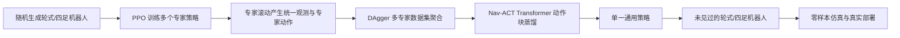
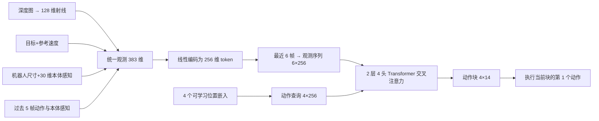

# 论文解读：X-Nav 跨载体端到端导航与 Nav-ACT Transformer

创建日期：2026-10-20

> 原文献：[[X-Nav Learning End-to-End Cross-Embodiment Navigation for Mobile Robots.pdf|点击打开 PDF]]
> Haitong Wang, Aaron Hao Tan, Angus Fung, Goldie Nejat. *X-Nav: Learning End-to-End Cross-Embodiment Navigation for Mobile Robots.* IEEE Robotics and Automation Letters, accepted October 2025. DOI: 10.1109/LRA.2025.3632119.

## 0. 一句话总结

X-Nav 先用 DRL 在大量随机生成的轮式与四足机器人上训练多个“拥有特权信息的专家策略”，再把多个专家通过 DAgger 蒸馏成一个统一策略。这个统一策略使用 Nav-ACT Transformer，把深度、目标、参考速度、本体感知和机器人尺寸编码成统一观测序列，一次预测未来 4 步、共 14 维的底层动作，从而无需为未知机器人单独设计速度跟踪器或动力学模型。

## 1. 论文要解决什么问题

传统导航策略通常绑定某个具体机器人：

- 轮式机器人直接输出线速度、角速度；
- 四足机器人输出关节目标；
- 不同机器人的尺寸、质量、腿部比例、电机能力、相机安装方式都不同；
- 已有跨载体方法常用“高层输出路点 + 底层控制器跟踪”的结构，这会引入额外的感知误差、控制器误差和多模块误差累积。

X-Nav 的目标是学习一个统一策略：

$$
\pi:\left(o_{depth},o_{proprio},l_g,v_{ref}\right)
\longrightarrow a,
$$

其中：

- $o_{depth}$ 是机载深度图像；
- $o_{proprio}$ 是 IMU、编码器等本体感知；
- $l_g$ 是二维目标位置；
- $v_{ref}$ 是参考速度；
- $a$ 是可以直接执行的底层动作。

与“输出一个路点，再让每个机器人自己的控制器去跟踪”不同，X-Nav 直接把观测映射到轮式速度或四足关节目标，因此部署时不需要额外的载体专用控制器。

## 2. 总体工作流程

![[图片库/X-Nav-总体架构.png]]

> 图 3 是论文的两阶段框架。左半部分是专家学习：随机生成机器人，配合特权观测训练 DRL 专家。右半部分是策略蒸馏：统一观测先编码成 token，再由 Nav-ACT 的 Transformer decoder 生成连续动作块；专家动作序列作为 DAgger 的监督标签。

整体流程可以压缩为：

### 2.1 第一阶段：训练多个专家策略

论文训练 $N_p=5$ 个专家，按机器人类型和环境难度分开：

| 专家类别 | 环境 | 机器人 |
|---|---|---|
| 轮式专家 | 随机障碍物 | 随机生成的轮式机器人 |
| 小型四足专家 | 随机障碍物 | 质量小于 30 kg 的四足 |
| 大型四足专家 | 随机障碍物 | 质量大于 30 kg 的四足 |
| 小型四足专家 | 楼梯、随机网格、强起伏地形 | 小型四足 |
| 大型四足专家 | 楼梯、随机网格、强起伏地形 | 大型四足 |

将四足分成大、小两类，是因为二者的惯性、力矩和动力学差异明显；划分后训练更稳定。

每个专家都使用 PPO，网络为 MLP，并在 Isaac Sim/Isaac Lab 中大规模并行训练。训练时机器人观测中包含：

- 机器人质量、三维尺寸；
- 四足的基座尺寸、基座质量、大腿/小腿尺寸与质量；
- 电机 PD 增益；
- 机器人周围的地形高度扫描；
- 四足的步态时序。

这些信息统称为**特权观测（privileged observations）**。真实部署时通常拿不到精确的腿部质量和地形高度，因此它们只帮助专家在仿真中做出更好的决策，不会直接作为最终通用策略的输入。

训练中还使用了：

- 机器人形态随机化；
- 摩擦系数和基座质量的域随机化；
- 随机推力扰动；
- 本体感知噪声和动作噪声；
- 电机执行延迟；
- 从简单到复杂的课程学习。

论文设置了 384 个 $10\times10$ m 的子区域，并包含圆柱、箱体、金字塔三类障碍物以及四足专用复杂地形。这样做的目标是让未来的真实机器人形态落在训练分布之内。

### 2.2 第二阶段：把多个专家蒸馏成一个通用策略

第二阶段并不直接把多个专家“平均”起来，而是让 Nav-ACT 在仿真中实际驾驶所有随机机器人，并用以下闭环收集数据：

1. 通用策略在当前状态输出一个动作块；
2. 执行动作块的第一个动作；
3. 找到该机器人对应的专家；
4. 查询专家在**同一状态**下的动作；
5. 把专家未来 4 步动作拼成监督动作块；
6. 将新状态、统一观测和专家动作块加入数据集；
7. 用均方误差训练 Nav-ACT。

这属于 DAgger 风格的在线数据聚合。与离线行为克隆相比，DAgger 会不断看到“通用策略自己走出来的状态”，因此可以减少分布漂移和误差累积。

### 2.3 第三阶段：部署

训练完成后，只保留通用策略 Nav-ACT。部署时输入目标、参考速度、深度图像和本体感知，直接输出底层动作：

- 轮式机器人：线速度、角速度；
- 四足机器人：12 个目标关节位置，由机器人自身的 PD 控制器执行。

论文在仿真中测试了未见过的 Jackal、Dingo、Create3、A1、Go2、ANYmal B；在真实世界中测试了 TurtleBot2 和 Jackal。

## 3. 统一观测与动作接口

跨载体的关键是先把不同机器人的数据放进一个统一坐标和统一向量中。

### 3.1 统一观测

论文定义：

$$
o_t^{uni}
=
\left[
l_{g,t},
v_{ref},
o_s,
o_{prio,t}^{uni},
o_{hist,t}^{uni},
o_{ray,t}
\right].
$$

各项含义和维度如下：

| 分量 | 含义 | 维度 |
|---|---|---:|
| $l_{g,t}$ | 二维目标位置 | 2 |
| $v_{ref}$ | 参考速度 | 1 |
| $o_s$ | 机器人基座长、宽 | 2 |
| $o_{prio,t}^{uni}$ | 统一本体感知 | 30 |
| $o_{hist,t}^{uni}$ | 过去 5 帧的统一动作与本体感知 | 220 |
| $o_{ray,t}$ | 从深度图提取的统一激光射线 | 128 |
| **合计** | 按论文定义拼接 | **383** |

其中历史项为：

$$
o_{hist,t}^{uni}
=
\left[
\left(a_{\tau}^{uni},o_{prio,\tau}^{uni}\right)
\right]_{\tau=t-N_{hist}+1}^{t},
\qquad N_{hist}=5.
$$

每帧历史包含 14 维动作和 30 维本体感知，因此共有

$$
5\times(14+30)=220
$$

维。

轮式机器人自身的本体感知通常只有二维速度和角速度；为了与四足机器人的 30 维本体感知对齐，论文用零填充补足缺失的关节位置和关节速度维度。

### 3.2 深度图到统一射线

不同机器人的深度相机的分辨率、安装高度和外参可能不同。X-Nav 没有直接把原始深度图送入 Transformer，而是先把深度像素投影到水平面，再在均匀间隔的角度上提取距离，插值成固定视角和固定数量的射线：

$$
\theta_{FOV}=90^\circ,
\qquad
N_{ray}=128,
\qquad
d_{ray}\in[0.2,8]\ \mathrm{m}.
$$

这样一来，不同相机配置都被转换为相同格式的 128 维距离向量，减少了对相机型号和外参的依赖。

### 3.3 统一动作

统一动作定义为 $a_t^{uni}\in\mathbb R^{14}$：

$$
a_t^{uni}
=
\begin{bmatrix}
\underbrace{v_x,\omega_z}_{\text{轮式速度}}\\
\underbrace{q_1,\ldots,q_{12}}_{\text{四足目标关节}}
\end{bmatrix}
\in\mathbb R^{14}.
$$

前两维表示轮式机器人的线速度与角速度，后 12 维表示四足机器人期望的 12 个关节位置。两种机器人共享同一个 14 维输出空间，但各自使用与自己执行器对应的子空间。论文没有在正文中逐项说明另一类机器人未使用的维度如何填充；复现时应以作者代码为准。

## 4. Transformer 模块 Nav-ACT 具体怎么工作

### 4.1 Nav-ACT 不是先输出路点

一般导航 Transformer 常输出路点或速度，再交给底层控制器跟踪。Nav-ACT 的目标更直接：

$$
o_t^{uni}
\longrightarrow
[a_t,a_{t+1},a_{t+2},a_{t+3}],
$$

即一次生成一个**动作块（action chunk）**，每个动作都是 14 维底层动作。这个设计把“观察环境”和“产生可执行动作”放进同一个网络里。

### 4.2 第一步：线性编码与时间堆叠

每个时刻的统一观测 $o_t^{uni}$ 先经过线性层：

$$
e_t
=
W_o o_t^{uni}+b_o,
\qquad
e_t\in\mathbb R^{256}.
$$

论文将最近 $S_o=6$ 个观测 token 堆叠为上下文：

$$
O_t
=
\left[
e_{t-S_o+1},
\ldots,
e_t
\right]
\in\mathbb R^{6\times256}.
$$

因此，Transformer 当前看到的不是单帧图像，而是“最近 6 个时刻的机器人状态、目标、射线和历史动作”。它可以从时间变化中判断速度趋势、障碍物接近速度和过去动作的效果。

注意：这里的线性编码器只改变单帧观测的特征空间，并不独立地对 6 帧做卷积或循环处理；时间关系由后面的 Transformer 跨 token 注意力建模。

### 4.3 第二步：用可学习动作查询生成动作块

Transformer decoder 的输入不是一句已有的“动作”，而是 $S_a=4$ 个可学习的位置嵌入：

$$
E_p
=
[e_{p,1},e_{p,2},e_{p,3},e_{p,4}]
\in\mathbb R^{4\times256}.
$$

可以把它们理解成四个“待填写的动作槽位”：

$$
\text{动作槽位}_1,\ldots,\text{动作槽位}_4.
$$

解码器让这些槽位通过注意力读取当前 6 帧观测，然后一次性输出：

$$
A_t
=
\left[
a_t,
a_{t+1},
a_{t+2},
a_{t+3}
\right]
\in\mathbb R^{4\times14}.
$$

论文的 $S_a=4$，也就是每次预测未来 4 个控制步。

### 4.4 第三步：多头注意力如何融合信息

从标准 Transformer 的 cross-attention 角度，可将动作位置嵌入视为 query，观测 token 视为 key 和 value：

$$
Q=E_pW_Q,
\qquad
K=O_tW_K,
\qquad
V=O_tW_V.
$$

注意力权重为：

$$
\operatorname{Attn}(Q,K,V)
=
\operatorname{softmax}
\left(
\frac{QK^\top}{\sqrt{d_k}}
\right)V.
$$

其直观含义是：

- $QK^\top$ 计算“每个动作槽位需要关注哪一帧观测”；
- softmax 把匹配分数变成概率分布；
- $V$ 保存 6 帧观测中的实际环境、目标和本体特征；
- 解码器把当前最相关的环境信息与机器人状态写回动作槽位。

例如，当机器人接近障碍物时，动作槽位可以通过高权重关注最近几帧的射线变化；当目标在侧面时，目标 token 和射线 token 会共同影响转向动作。

论文使用 4 个注意力头，因此可以并行学习不同的关系模式，例如：

- 目标方向与运动方向；
- 本体尺寸与可行动作幅度；
- 射线距离与避障时机；
- 历史动作与当前动力学响应。

**论文明确说明**观测序列用于 cross-attention；但它没有逐层公开 decoder 中 self-attention、mask 方式和输出投影的具体配置。因此这里可以按标准 decoder 的 Q/K/V 机制理解，但不应把论文未写出的细节当成已经验证的实现细节。

### 4.5 为什么一次输出整块动作

逐时间步单独预测容易出现抖动，且每一步都要重新前向推理。动作块预测有三个作用：

1. **时间一致**：4 个动作在同一个前向过程中联合生成，可减少相邻动作不连贯；
2. **计算效率高**：一次前向得到 4 步动作；
3. **表达前瞻**：当前动作可以在未来几步的约束下被生成，而不用等下一帧再临时修正。

但动作块也不是把 4 个动作全部盲目执行。论文的 DAgger 训练和执行策略会在下一节说明。

### 4.6 论文给出的 Nav-ACT 配置

| 项目 | 配置 |
|---|---:|
| 输入观测序列长度 $S_o$ | 6 |
| 动作块长度 $S_a$ | 4 |
| 本体感知历史 $N_{hist}$ | 5 |
| 激光射线数 | 128 |
| 射线视野 | $90^\circ$ |
| token 嵌入维度 | 256 |
| Transformer 层数 | 2 |
| 注意力头数 | 4 |
| 统一动作维度 | 14 |
| 蒸馏 batch size | 28672 |
| 学习率 | $10^{-4}$ |
| 优化器 | Adam |
| 权重衰减 | $10^{-3}$ |
| 蒸馏迭代次数 | 5000 |

### 4.7 用一条数据流概括 Transformer

## 5. DAgger 如何给 Transformer 提供监督

训练时，Nav-ACT 和所有随机机器人在仿真中并行运行。对某个机器人 $\mathcal R$：

1. Nav-ACT 输入 $o_t^{uni}$，预测 $A_t=[a_t,\ldots,a_{t+3}]$；
2. 实际执行第一个动作 $a_t=A_t[0]$；
3. 找到该机器人的专家 $\pi_{e,\mathcal R}$；
4. 专家根据当前状态产生专家动作 $a_t^e$；
5. 收集未来 4 步专家动作 $[a_t^e,\ldots,a_{t+3}^e]$；
6. 用动作块均方误差训练 Nav-ACT。

损失函数为：

$$
\mathcal L_{\mathrm{MSELoss}}
=
\frac{1}{S_a}
\sum_{i=0}^{S_a-1}
\left\|
A_t[i]-A_t^e[i]
\right\|_2^2.
$$

这比普通离线行为克隆多了两个关键点：

- 数据不是只来自专家轨迹，而是来自“通用策略实际访问到的状态”；
- 标签不是单个动作，而是一整段专家动作块。

当 Nav-ACT 走到专家数据没有覆盖的状态时，DAgger 会继续向对应专家请求纠偏动作，从而缓解误差累积。

## 6. 推理时如何使用动作块

### 6.1 轮式机器人：时序集成

轮式机器人对平滑性较敏感。若每个时间步都只采用最新一次预测的第一个动作，目标或估计稍有变化就可能造成速度突变。

论文对轮式机器人采用 temporal ensemble（TE）：

- 保留最近 $S_f=5$ 次预测的动作块；
- 对不同历史预测中指向当前时刻的动作进行加权平均；
- 通过时序平滑降低抖动。

训练时论文使用误差平方和作为动作块损失；消融实验中 L1 版本的性能低于 L2，说明较大的动作误差需要被更强烈地惩罚。

### 6.2 四足机器人：只执行最新块的第一个动作

四足机器人的动作是关节位置，动态响应和平衡控制更敏感。历史动作的平滑平均反而可能让机器人响应变慢，甚至失去平衡。

因此四足机器人在每个时刻只取最新动作块的第一个动作：

$$
a_t=A_t[0].
$$

消融结果表明：

- 去掉轮式机器人的 TE，Jackal 的成功率从 88.3% 降到 76.3%；
- 给四足机器人强行加入 TE，Go2 的成功率从 69.5% 降到 43.3%。

这说明“动作块如何执行”需要与载体动力学匹配，Transformer 结构本身不能代替这个执行策略。

## 7. 实验结果

### 7.1 与 SOTA 在未见机器人上的比较

每个方法、每个机器人执行 1000 次试验。论文使用成功率 SR 和路径效率 SPL：

| 方法 | Go2 SR/SPL | A1 SR/SPL | ANYmal B SR/SPL | Jackal SR/SPL | Dingo SR/SPL | Create3 SR/SPL |
|---|---:|---:|---:|---:|---:|---:|
| ViNT | 45.3 / 0.41 | 58.6 / 0.48 | 35.3 / 0.30 | 65.7 / 0.59 | 56.8 / 0.48 | 79.9 / 0.74 |
| NavDP | 53.1 / 0.48 | 57.8 / 0.52 | 37.2 / 0.29 | 70.2 / 0.64 | 71.0 / 0.63 | 82.4 / 0.73 |
| **X-Nav** | **69.5 / 0.61** | **73.1 / 0.62** | **60.5 / 0.53** | **88.3 / 0.82** | **84.0 / 0.78** | **91.7 / 0.85** |

论文给出的主要解释是：

- X-Nav 直接把观测映射到低层动作，减少“路点预测 + PD 控制器/四足运动控制器”的误差累积；
- 本体感知和机器人尺寸让策略能够适应不同形态；
- 统一射线表示减少了相机配置差异的影响。

### 7.2 随机载体数量增加带来的收益

作者比较了在策略蒸馏阶段使用 128、1024、4096 个随机机器人时的性能。总体趋势是：

$$
\text{更多随机载体}
\longrightarrow
\text{更宽的形态覆盖}
\longrightarrow
\text{更好的 SR 与 SPL}.
$$

这说明单一策略并不是靠某个固定机器人模板工作，而是从多样化的形态与动力学中隐式学习到了“如何根据自身状态调整动作”。

### 7.3 真实世界实验

真实部署没有额外训练，运行在 ROS Noetic、50 Hz：

| 方法 | 平均成功率 SR | 平均 SPL |
|---|---:|---:|
| ViNT | 70% | 0.63 |
| NavDP | 65% | 0.60 |
| **X-Nav** | **80%** | **0.71** |

真实实验使用 TurtleBot2 与 Jackal：

- TurtleBot2 搭配 Kinect，通过走廊和狭窄门口；
- Jackal 搭配 ZED 2，通过窄走廊和户外不平整公园；
- 论文还展示了一次从 L 形死角主动转向离开的案例。

值得注意的是，论文的真实世界实验覆盖的是两类轮式机器人，四足机器人的验证主要在仿真中完成。

## 8. 这套 Transformer 设计的关键理解

### 8.1 它融合的不是四种模态，而是四类控制知识

观测 token 背后实际携带四类信息：

1. **任务知识**：目标位置和参考速度；
2. **身体知识**：尺寸、质量相关的可观测代理以及本体感知；
3. **历史知识**：过去动作与身体响应；
4. **环境知识**：从深度图转换来的统一射线。

注意力机制并不是“自己理解物理”，而是学习如何在这些特征之间分配权重。物理适应性仍然来自：

- 随机生成的机器人形态；
- DRL 专家的动力学经验；
- 统一动作空间；
- DAgger 的闭环纠偏；
- 域随机化与真实传感器输入。

### 8.2 跨载体能力的来源是一条系统链路

不能把 X-Nav 的成功只归因于“用了 Transformer”。更完整的因果关系是：

$$
\boxed{
\text{随机载体训练}
+
\text{统一观测/动作}
+
\text{多专家蒸馏}
+
\text{Transformer 动作块}
\longrightarrow
\text{跨载体策略}
}
$$

其中 Transformer 的主要贡献是：

- 处理 6 帧观测序列；
- 动态融合目标、本体、历史和射线；
- 一次生成 4 步动作；
- 用一个统一参数化网络适配不同动作语义。

### 8.3 论文没有公开的细节

阅读和复现时需要注意，论文正文没有给出以下全部实现细节：

- decoder 中是否使用 self-attention，以及是否采用因果 mask；
- observation token 是否也加入时间位置编码；
- 注意力层、残差、归一化和输出动作头的逐层结构；
- 14 维动作中两类机器人未使用维度的完整填充规则。

这些问题最好查看作者代码。只根据论文，可以确定的是：使用 $S_o=6$ 的观测序列、$S_a=4$ 的动作查询位置嵌入、2 层 4 头注意力、256 维嵌入，并通过观测序列的 cross-attention 一次性生成动作块。

## 9. 主要限制

1. **动作空间只覆盖轮式和 12 自由度四足。** 论文的下一步是将统一动作空间扩展到不同自由度机器人，如 humanoid。
2. **“零样本”是分布内泛化。** 它表示训练时没见过某个具体商业机器人，但这些机器人仍需落在随机生成形态的覆盖范围内。
3. **四足真实世界验证有限。** 模拟中测试了多种四足，真实世界实验主要是轮式机器人。
4. **多专家质量决定蒸馏上限。** 通用策略依赖对应专家的覆盖情况；专家训练环境、奖励和特权信息的偏差会传递给最终策略。
5. **只有二维目标。** 当前任务是位置目标导航，不含“去找到某个物体”的语义目标。
6. **二维射线是压缩但非完整环境表示。** 它有利于相机泛化并降低输入维度，但也可能丢失部分垂直结构和高程细节，尤其在四足复杂地形中。
7. **动作块需要与动力学匹配。** 轮式适合时序集成，四足必须优先响应最新状态；改善 Transformer 不能替代推理阶段的载体相关执行策略。

## 10. 记忆框架

把 X-Nav 记成“二阶段、两个统一、一个动作块”：

$$
\boxed{
\text{专家 DRL}
\rightarrow
\text{DAgger 蒸馏}
\rightarrow
\text{Nav-ACT}
\rightarrow
\text{零样本部署}
}
$$

- **两个统一**：统一观测接口、统一 14 维动作空间；
- **一个动作块**：由一个前向过程生成未来 4 步动作；
- **专家输入有特权信息，通用策略输入只依赖部署时可获得的信息**；
- **Transformer 的核心**：动作位置 token 作为 query，最近 6 帧观测作为 key/value，通过多头 cross-attention 融合任务、身体、历史和射线信息；
- **跨载体不是靠一个额外控制器**：策略直接输出各载体可执行的底层动作。
