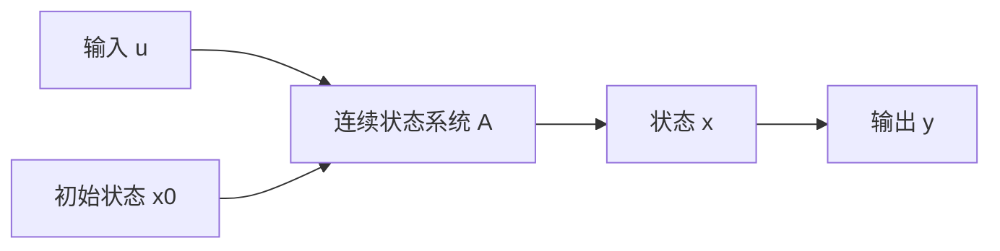

# 可控性、可达性与可观性：为什么可观性等价于零输入响应

创建日期：2026-10-26

## 0. 一句话总结

- **可控/可达性**研究：能不能在有限时间内用输入 $u$ 把状态从 $x_0$ 搬到 $x_1$。
- **可观性**研究：已知输入 $u$ 后，能不能根据输出 $y$ 在有限时间内的完整记录反推出未知初始状态 $x_0$。
- 由于 LTI 系统满足叠加原理，输出中的输入贡献可以单独算出并从 $y$ 中减去；剩下的正好是零输入响应。因此，“由 $y$ 反推 $x_0$”与“由零输入响应反推 $x_0$”是同一个反问题。

> 记号修正：可观性要反推的是**未知初始状态 $x_0$**，不是输入 $u$。标准可观性问题默认输入 $u(t)$ 已知；若输入也未知，就变成“输入—状态联合估计”，需要额外条件或观测器设计，不能直接套普通可观性定义。

## 1. 先写清 LTI 状态空间

考虑连续时间 LTI 系统：

$$
\dot{\mathbf x}(t)=A\mathbf x(t)+B\mathbf u(t),
\qquad
\mathbf y(t)=C\mathbf x(t)+D\mathbf u(t).
$$

其中：

- $\mathbf x\in\mathbb R^n$ 是状态；
- $\mathbf u\in\mathbb R^p$ 是输入；
- $\mathbf y\in\mathbb R^m$ 是输出；
- $A$ 描述系统自身如何演化；
- $B$ 描述输入从哪些方向进入状态空间；
- $C$ 描述哪些状态组合能被输出看到。

可以把它想成一个“双向信息问题”：

- 从 $u$ 到状态，是**控制**方向；
- 从 $y$ 反推状态，是**观测**方向。

## 2. 可控性与可达性

### 2.1 先区分“某一个转移”与“完全可控”

如果只问一对确定的初态和目标：

> 存在某个有限时刻 $t_1>t_0$ 和某个容许输入 $u:[t_0,t_1]\to\mathbb R^p$，使系统从 $x(t_0)=x_0$ 出发，在 $t_1$ 到达 $x(t_1)=x_1$。

这只能说明**这一对状态之间可以转移**。它并不自动说明任意初态都能到达任意目标。

现代控制理论里的“完全可控”要把量词补全：

> 对状态空间中的**任意** $x_0,x_1\in\mathbb R^n$，都存在有限时刻 $t_1>t_0$ 和一个平方可积输入 $u(t)$，使得 $x(t_0)=x_0$ 且 $x(t_1)=x_1$。

如果没有输入幅值、速率等约束，LTI 连续系统的“完全可控”也常直接称为“状态完全可达”。对单个转移，若目标恰好落在可达子空间里，哪怕系统不完全可控，也可能能够完成那一次转移。

#### 两种常见定义

| 名称 | 初始状态/目标 | 常见表述 |
|---|---|---|
| 可达性 | $0\to x_1$ | 从零状态出发，能否到达任意 $x_1$ |
| 可控性 | $x_0\to 0$ | 能否把任意初态控制回原点 |
| 状态完全可控 | 任意 $x_0\to$ 任意 $x_1$ | 任意两个状态之间都能在有限时间内转移 |

对于无约束的连续 LTI 系统，这三种“完全意义”上的定义是等价的。

### 2.2 为什么 LTI 下可达与完全可控等价

假设从零状态能到达任意状态。给定任意初态 $x_0$ 和目标 $x_1$，先让 $x_0$ 在 $[t_0,t_1]$ 内自然演化到

$$
e^{A(t_1-t_0)}x_0.
$$

希望总状态变化量为

$$
\Delta=x_1-e^{A(t_1-t_0)}x_0.
$$

既然从零状态出发能产生任意状态增量，就存在一个输入 $u_u$，使

$$
\int_{t_0}^{t_1}e^{A(t_1-\tau)}B u_u(\tau)\,\mathrm d\tau=\Delta.
$$

由叠加原理，同一个输入把原来从 $x_0$ 出发的状态推到

$$
e^{A(t_1-t_0)}x_0+\Delta=x_1.
$$

反过来，如果任意初态都能到任意目标，只取 $x_0=0$，就得到“从零状态到任意目标可达”。所以二者在 LTI 线性叠加意义下等价。

### 2.3 用状态方程直接看“输入能补多少”

连续系统的解是

$$
\mathbf x(t_1)
=
e^{A(t_1-t_0)}\mathbf x_0
+
\int_{t_0}^{t_1}
e^{A(t_1-\tau)}B\mathbf u(\tau)
\,\mathrm d\tau.
$$

要从 $x_0$ 到 $x_1$，需要输入产生

$$
\Delta
=
\mathbf x_1
-
e^{A(t_1-t_0)}\mathbf x_0.
$$

于是问题变成：

$$
\boxed{
\text{是否存在 }u(t),
\quad
\int_{t_0}^{t_1}
e^{A(t_1-\tau)}B u(\tau)\,\mathrm d\tau
=
\Delta
?}
$$

如果所有可能的 $\Delta$ 都能由输入产生，就是完全可控。

### 2.4 可控性 Gramian 给出显式输入

定义有限时间可控性 Gramian：

$$
W_c(t_0,t_1)
=
\int_{t_0}^{t_1}
e^{A(t_1-\tau)}B B^{\mathrm T}
e^{A^{\mathrm T}(t_1-\tau)}
\,\mathrm d\tau.
$$

若 $W_c(t_0,t_1)$ 可逆，则一组能把 $x_0$ 搬到 $x_1$ 的输入是

$$
\boxed{
\mathbf u(\tau)
=
B^{\mathrm T}
e^{A^{\mathrm T}(t_1-\tau)}
W_c^{-1}(t_0,t_1)
\left(
\mathbf x_1-e^{A(t_1-t_0)}\mathbf x_0
\right)
}.
$$

把它代回积分，得到

$$
\int_{t_0}^{t_1}
e^{A(t_1-\tau)}B\mathbf u(\tau)\,\mathrm d\tau
=
W_cW_c^{-1}\Delta
=
\Delta.
$$

所以状态确实到达 $x_1$。

#### 读这个公式

- $e^{A(t_1-\tau)}B$：$\tau$ 时刻的输入先进入状态空间，再传播到终点 $t_1$；
- $W_c$：所有控制方向在终点被“累积”起来的 Gramian；
- $W_c^{-1}\Delta$：为了产生目标变化量，需要怎样的控制坐标；
- 前面的一串矩阵转置：把控制坐标映射回真实输入通道。

如果 $W_c$ 奇异，就至少有一个状态方向永远无法由输入补到，因而不能做到任意 $x_0\to x_1$。

## 3. 可观性：从输出反推初态

### 3.1 可观性的严格定义

连续 LTI 系统在有限区间 $[t_0,t_1]$ 上称为完全可观，如果：

> 对任意两个未知初始状态 $x_{0a},x_{0b}$，在给定同一个已知输入 $u(t)$ 时，只要它们在区间上产生完全相同的输出 $y(t)$，就必然有 $x_{0a}=x_{0b}$。

也就是说，从完整输出记录到初始状态，是一个**单射**：

$$
\mathbf x_0
\longmapsto
\mathbf y(\cdot)
$$

没有两个不同的初态会产生完全一样的输出。

注意“输出”不是一个时刻的单个数字。对 $n$ 维单输出系统，通常需要一段区间上的输出曲线，或者 $n$ 个独立的输出信息，才可能确定 $n$ 个未知初态。仅测一瞬间的 $y(t_0)$ 一般只有一个标量信息。

### 3.2 输出由两部分组成

连续 LTI 的输出为

$$
\mathbf y(t)
=
\underbrace{
C e^{A(t-t_0)}\mathbf x_0
}_{\text{零输入响应 }y_0(t)}
+
\underbrace{
C\int_{t_0}^{t}
e^{A(t-\tau)}B\mathbf u(\tau)\,\mathrm d\tau
+
D\mathbf u(t)
}_{\text{零状态响应，由已知输入产生}}.
$$

这里把“零输入响应”理解为：**只把初值 $x_0$ 当作未知量的那一部分输出**。它不是要求实际系统一定没有输入。

如果输入 $u(t)$、矩阵 $A,B,C,D$ 和初始时刻 $t_0$ 都已知，那么零状态响应

$$
\mathbf y_{\mathrm{zs}}(t)
=
C\int_{t_0}^{t}
e^{A(t-\tau)}B\mathbf u(\tau)\,\mathrm d\tau
+
D\mathbf u(t)
$$

可以事先算出来并从测量输出中减去：

$$
\boxed{
\bar{\mathbf y}(t)
=
\mathbf y(t)-\mathbf y_{\mathrm{zs}}(t)
=
C e^{A(t-t_0)}\mathbf x_0
}.
$$

接着再除去输入直接通过 $D$ 到达输出的部分，剩余量只由未知初态 $x_0$ 决定。因此：

$$
\boxed{
\text{由 }(\mathbf u,\mathbf y)\text{ 求 }\mathbf x_0
\quad
\Longleftrightarrow
\quad
\text{由零输入响应 }\bar{\mathbf y}=Ce^{A(t-t_0)}x_0\text{ 求 }x_0
}.
$$

这里的“等价”不是物理上把输入强行设为 0，而是通过线性叠加把已知输入的贡献消掉，**数学上只保留与未知初态有关的部分**。

### 3.3 为什么可观性等同于求零输入响应

可以把逻辑拆成三步：

#### 第一步：输入的作用是可计算、可消除的

LTI 系统满足叠加原理：

$$
\mathbf y
=
\text{零输入响应}
+
\text{零状态响应}.
$$

零状态响应的计算只用到已知输入 $u$ 和系统矩阵 $A,B,C,D$。既然它是已知的，就可以从总输出中减掉：

$$
\bar{\mathbf y}
=
\mathbf y-\text{已知的零状态响应}.
$$

减完之后，系统相当于只剩“初值 $x_0$ 引起的自由响应”需要解释。

#### 第二步：两个初态能否区分，只取决于它们的零输入响应

若有 $x_{0a}\ne x_{0b}$，在同一个已知输入下产生相同输出 $y$，那么它们对应的零输入响应也必然相同：

$$
C e^{A(t-t_0)}x_{0a}
=
C e^{A(t-t_0)}x_{0b}.
$$

这说明零输入响应无法区分这两个初态。反过来，如果任意两个不同初态的零输入响应都不同，那么先减去输入响应后，就能唯一确定 $x_0$。

#### 第三步：零输入响应是 $x_0$ 的线性映射

零输入响应为

$$
\mathbf y_0(t)
=
C e^{A(t-t_0)}\mathbf x_0.
$$

这是一个从 $\mathbb R^n$ 到输出函数空间的线性映射。可观性要求这个线性映射是单射，也就是它的核为零：

$$
\ker\left[
\mathbf x_0\mapsto C e^{A(t-t_0)}\mathbf x_0
\right]
=
\{0\}.
$$

如果存在非零的 $\xi$ 使

$$
C e^{A(t-t_0)}\xi
=
0
\quad
\text{对所有 }t\in[t_0,t_1],
$$

那么初态 $x_0$ 和 $x_0+\xi$ 会产生完全相同的输出，二者的差就无法被观测。

### 3.4 从零输入响应的导数导出可观性矩阵

在 $t=t_0$ 时，零输入输出及其各阶导数为

$$
\mathbf y_0(t_0)
=
C\mathbf x_0,
$$

$$
\dot{\mathbf y}_0(t_0)
=
CA\mathbf x_0,
$$

$$
\ddot{\mathbf y}_0(t_0)
=
CA^2\mathbf x_0,
$$

$$
\vdots
$$

$$
\mathbf y_0^{(n-1)}(t_0)
=
CA^{n-1}\mathbf x_0.
$$

把它们堆叠起来：

$$
\begin{bmatrix}
\mathbf y_0(t_0)\\
\dot{\mathbf y}_0(t_0)\\
\vdots\\
\mathbf y_0^{(n-1)}(t_0)
\end{bmatrix}
=
\underbrace{
\begin{bmatrix}
C\\
CA\\
\vdots\\
CA^{n-1}
\end{bmatrix}
}_{\mathcal O}
\mathbf x_0.
$$

因此，能从输出曲线唯一反推 $x_0$，就等价于这个矩阵方程能够唯一求解 $x_0$。这个条件就是下一节要单独列出的**可观性秩判据**。

### 3.5 用零输入响应看两个具体例子

取

$$
A=
\begin{bmatrix}
-1&0\\
0&-2
\end{bmatrix},
\qquad
C=
\begin{bmatrix}
1&1
\end{bmatrix}.
$$

零输入响应为

$$
y_0(t)
=
\begin{bmatrix}
1&1
\end{bmatrix}
\begin{bmatrix}
e^{-t}&0\\
0&e^{-2t}
\end{bmatrix}
\begin{bmatrix}
x_{10}\\
x_{20}
\end{bmatrix}
=
e^{-t}x_{10}+e^{-2t}x_{20}.
$$

可观性矩阵为

$$
\mathcal O
=
\begin{bmatrix}
C\\
CA
\end{bmatrix}
=
\begin{bmatrix}
1&1\\
-1&-2
\end{bmatrix},
\qquad
\det\mathcal O=-1\ne0.
$$

所以完全可观。输出曲线中的 $e^{-t}$ 与 $e^{-2t}$ 两种模态分别携带 $x_{10}$ 和 $x_{20}$ 的信息，能够把它们分开。

再看

$$
A=
\begin{bmatrix}
-1&0\\
0&-2
\end{bmatrix},
\qquad
C=
\begin{bmatrix}
1&0
\end{bmatrix}.
$$

此时

$$
y_0(t)=e^{-t}x_{10}.
$$

输出完全看不到 $x_{20}$。对应的可观性矩阵

$$
\mathcal O
=
\begin{bmatrix}
1&0\\
-1&0
\end{bmatrix},
\qquad
\operatorname{rank}\mathcal O=1<2,
$$

因此不可观。任何 $x_{20}$ 的变化都不会改变零输入响应，无论输入怎么选，也无法通过扣除输入响应把这个隐藏模态变出来。

## 4. 可控性与可观性的三类判据

下面只讨论连续 LTI 系统

$$
\dot x=Ax+Bu,
\qquad
y=Cx+Du,
\qquad
x\in\mathbb R^n.
$$

三种判据回答的是同一个问题，只是检查角度不同：

- 秩判据：直接检查 $B,AB,\dots$ 或 $C,CA,\dots$ 是否张满状态空间；
- PBH 判据：逐个特征值检查是否存在“输入无法进入”或“输出无法看到”的方向；
- 若当标准形判据：把系统分解成独立的模态块，检查输入、输出是否连接到每个块的关键位置。

| 判据 | 可控性 | 可观性 |
|---|---|---|
| 秩判据 | $\operatorname{rank}[B\ AB\ \cdots\ A^{n-1}B]=n$ | $\operatorname{rank}\begin{bmatrix}C\\CA\\\vdots\\CA^{n-1}\end{bmatrix}=n$ |
| PBH 判据 | $\operatorname{rank}[\lambda_i I-A\ \ B]=n$ | $\operatorname{rank}\begin{bmatrix}\lambda_i I-A\\ C\end{bmatrix}=n$ |
| 若当标准形判据 | 同特征值的各块末行对应的输入行满秩 | 同特征值的各块首列对应的输出列满秩 |

### 4.1 秩判据

#### 可控性秩判据

构造可控性矩阵

$$
\mathcal C
=
\begin{bmatrix}
B & AB & A^2B & \cdots & A^{n-1}B
\end{bmatrix}.
$$

系统完全可控，当且仅当

$$
\boxed{
\operatorname{rank}\mathcal C=n
}.
$$

直观上，$B$ 是输入直接进入状态空间的方向，$AB$ 是输入经过一次系统演化后能够到达的方向，依此类推；如果这些方向合起来张成整个 $\mathbb R^n$，就能控制所有状态方向。

#### 可观性秩判据

构造可观性矩阵

$$
\mathcal O
=
\begin{bmatrix}
C\\
CA\\
CA^2\\
\vdots\\
CA^{n-1}
\end{bmatrix}.
$$

系统完全可观，当且仅当

$$
\boxed{
\operatorname{rank}\mathcal O=n
}.
$$

这里的各行分别来自零输入响应及其导数：

$$
y_0(t_0)=Cx_0,
\quad
\dot y_0(t_0)=CAx_0,
\quad
\dots,
\quad
y_0^{(n-1)}(t_0)=CA^{n-1}x_0.
$$

只有输出及其各阶导数合起来足以唯一确定 $n$ 个初态，才是完全可观。

### 4.2 PBH 判据

PBH 判据把“整体矩阵是否满秩”转化为“每个特征模态是否被输入或输出连接”。

#### 可控性 PBH 判据

系统完全可控，当且仅当对每一个特征值 $\lambda_i$ 都有

$$
\boxed{
\operatorname{rank}
\begin{bmatrix}
\lambda_i I-A & B
\end{bmatrix}
=n
}.
$$

若某个特征值处该矩阵降秩，就存在一个状态方向，它既不能由输入直接推动，也不能通过其他状态间接到达，这个模态就是不可控的。

实际计算时，只需要检查 \(A\) 的不同特征值。重根不需要重复计算，因为 PBH 判据在同一个特征值上使用同一组矩阵。

#### 可观性 PBH 判据

系统完全可观，当且仅当对每一个特征值 $\lambda_i$ 都有

$$
\boxed{
\operatorname{rank}
\begin{bmatrix}
\lambda_i I-A\\
C
\end{bmatrix}
=n
}.
$$

若某个特征值处该矩阵降秩，就存在一个状态方向，它只能沿该模态运动，却不影响任何输出，因此无法从零输入响应中反演出来。

### 4.3 若当标准形判据（判据 2）

若 $A$ 不可对角化，可以先取广义特征向量矩阵 $P$，化成若当标准形：

$$
J=P^{-1}AP,
\qquad
\tilde B=P^{-1}B,
\qquad
\tilde C=CP.
$$

变换后系统为

$$
\dot{\tilde x}=J\tilde x+\tilde B u,
\qquad
y=\tilde C\tilde x+Du.
$$

若当标准形由若干若当块组成。对每个特征值 $\lambda$，记与其对应的若当块个数为 $q_\lambda$。

#### 可控性的若当标准形判据

对每个特征值 $\lambda$，在所有属于 $\lambda$ 的若当块中，取出每个块的**最后一行**所对应的 $\tilde B$ 行，组成矩阵

$$
\tilde B_\lambda\in\mathbb R^{q_\lambda\times p}.
$$

系统完全可控，当且仅当对每个 $\lambda$ 都有

$$
\boxed{
\operatorname{rank}\tilde B_\lambda
=
q_\lambda
}.
$$

也就是说，同一个特征值下的每个若当块，都能被输入独立激励。

#### 可观性的若当标准形判据

对每个特征值 $\lambda$，在所有属于 $\lambda$ 的若当块中，取出每个块的**第一行**所对应的 $\tilde C$ 列，组成矩阵

$$
\tilde C_\lambda\in\mathbb R^{m\times q_\lambda}.
$$

系统完全可观，当且仅当对每个 $\lambda$ 都有

$$
\boxed{
\operatorname{rank}\tilde C_\lambda
=
q_\lambda
}.
$$

也就是说，同一个特征值下的每个若当块，都能在输出中独立显示出来。

#### 单输入/单输出时的简化

当系统是单输入时，$\tilde B_\lambda$ 只有一列，因此：

- 若要可控，每个特征值只能对应一个若当块；
- 每个若当块最后一行的输入系数必须非零。

当系统是单输出时，$\tilde C_\lambda$ 只有一行，因此：

- 若要可观，每个特征值只能对应一个若当块；
- 每个若当块第一列的输出系数必须非零。

以最直观的 $2\times2$ 若当块为例：

$$
J=
\begin{bmatrix}
\lambda&1\\
0&\lambda
\end{bmatrix},
\qquad
\tilde B=
\begin{bmatrix}
b_1\\
b_2
\end{bmatrix},
\qquad
\tilde C=
\begin{bmatrix}
c_1&c_2
\end{bmatrix}.
$$

则：

$$
\text{可控}
\iff b_2\ne0,
\qquad
\text{可观}
\iff c_1\ne0.
$$

控制输入必须进入若当块的**末端状态**，才能通过链式耦合影响整个块；输出必须从若当块的**首端状态**取得信息，才能看到整个块的动态。

> 同一特征值存在多个若当块时，不能只检查“每个末行非零”或“每个首列非零”，还要检查这些行或列之间是否线性无关。若当标准形判据的秩条件正是用来处理这种情况。

### 4.4 若当标准形判据的例子

考虑一个四维系统，它的状态矩阵已经处于若当标准形：

$$
J=
\begin{bmatrix}
2&1&0&0\\
0&2&0&0\\
0&0&2&1\\
0&0&0&2
\end{bmatrix}
=
\begin{bmatrix}
J_1&0\\
0&J_2
\end{bmatrix}.
$$

其中

$$
J_1=
\begin{bmatrix}
2&1\\
0&2
\end{bmatrix},
\qquad
J_2=
\begin{bmatrix}
2&1\\
0&2
\end{bmatrix}.
$$

这里只有特征值 $\lambda=2$，但是它对应两个若当块，所以

$$
q_2=2.
$$

按状态向量顺序把两个若当块写成：

$$
\text{块 1}=
\begin{bmatrix}
x_1\\
x_2
\end{bmatrix},
\qquad
\text{块 2}=
\begin{bmatrix}
x_3\\
x_4
\end{bmatrix}.
$$

因此 $x_1,x_3$ 分别是两个若当块的首状态，$x_2,x_4$ 分别是两个若当块的末状态。

#### 可控性：检查两个末行

取输入矩阵

$$
B=
\begin{bmatrix}
0&0\\
1&0\\
0&0\\
0&1
\end{bmatrix}.
$$

属于 $\lambda=2$ 的两个若当块的末行分别是第 2 行和第 4 行，因此

$$
B_2=
\begin{bmatrix}
1&0\\
0&1
\end{bmatrix},
\qquad
\operatorname{rank}B_2=2=q_2.
$$

所以系统在特征值 $2$ 处可控。直观上：

- 第一个输入作用在 $J_1$ 的末状态，再由若当块内的耦合影响块 1 的首状态；
- 第二个输入作用在 $J_2$ 的末状态，再由若当块内的耦合影响块 2 的首状态。

两个输入分别控制两个同特征值的块，因此它们可以被独立激励。

如果误取

$$
B'=
\begin{bmatrix}
0&0\\
1&0\\
0&0\\
1&0
\end{bmatrix},
$$

虽然两个末行都非零，但是

$$
B'_2=
\begin{bmatrix}
1&0\\
1&0
\end{bmatrix},
\qquad
\operatorname{rank}B'_2=1<2.
$$

两个若当块的输入方向线性相关，无法独立控制，因此系统不可控。这说明不能只检查“每个末行是否为 0”，必须检查它们是否张成 $q_\lambda$ 维空间。

#### 可观性：检查两个首列

取输出矩阵

$$
C=
\begin{bmatrix}
1&0&0&0\\
0&0&1&0
\end{bmatrix}.
$$

属于两个若当块的首列分别是第 1 列和第 3 列，因此

$$
C_2=
\begin{bmatrix}
1&0\\
0&1
\end{bmatrix},
\qquad
\operatorname{rank}C_2=2=q_2.
$$

所以系统在特征值 $2$ 处可观：

- 第一个输出测量块 1 的首状态；
- 第二个输出测量块 2 的首状态；
- 两个块内部都有“末状态影响首状态”的耦合链，因此测量首状态后可以观察整个块。

若误取

$$
C'=
\begin{bmatrix}
1&0&1&0\\
2&0&2&0
\end{bmatrix},
$$

则两个首列虽然都非零，但是

$$
C'_2=
\begin{bmatrix}
1&1\\
2&2
\end{bmatrix},
\qquad
\operatorname{rank}C'_2=1<2.
$$

两个输出向量线性相关，无法区分两个若当块，因此系统不可观。

这个例子说明若当判据的核心：

$$
\boxed{
\begin{aligned}
\text{可控} &\iff
\text{每个 }\lambda\text{ 的各若当块末行对应的输入行线性无关},\\
\text{可观} &\iff
\text{每个 }\lambda\text{ 的各若当块首列对应的输出列线性无关}.
\end{aligned}
}
$$

### 4.5 一个简单的秩判据例子

考虑二维 LTI 系统

$$
A=
\begin{bmatrix}
0&1\\
-2&-3
\end{bmatrix},
\qquad
B=
\begin{bmatrix}
0\\
1
\end{bmatrix},
\qquad
C=
\begin{bmatrix}
1&0
\end{bmatrix}.
$$

#### 检查可控性

先计算

$$
AB=
\begin{bmatrix}
0&1\\
-2&-3
\end{bmatrix}
\begin{bmatrix}
0\\
1
\end{bmatrix}
=
\begin{bmatrix}
1\\
-3
\end{bmatrix}.
$$

于是

$$
\mathcal C
=
\begin{bmatrix}
B&AB
\end{bmatrix}
=
\begin{bmatrix}
0&1\\
1&-3
\end{bmatrix},
\qquad
\det\mathcal C=-1\ne0.
$$

所以

$$
\operatorname{rank}\mathcal C=2=n,
$$

系统完全可控。

#### 检查可观性

先计算

$$
CA=
\begin{bmatrix}
1&0
\end{bmatrix}
\begin{bmatrix}
0&1\\
-2&-3
\end{bmatrix}
=
\begin{bmatrix}
0&1
\end{bmatrix}.
$$

于是

$$
\mathcal O
=
\begin{bmatrix}
C\\
CA
\end{bmatrix}
=
\begin{bmatrix}
1&0\\
0&1
\end{bmatrix},
\qquad
\operatorname{rank}\mathcal O=2=n.
$$

因此系统完全可观。

这个例子也说明了两个判据的区别：

- 可控性矩阵从 $B$ 出发，观察输入经过 $A$ 能覆盖哪些状态方向；
- 可观性矩阵从 $C$ 出发，观察初值经过 $A$ 后如何出现在输出和输出导数中。

## 5. 可观性 Gramian 与反演公式

定义有限时间可观性 Gramian：

$$
W_o(t_0,t_1)
=
\int_{t_0}^{t_1}
e^{A^{\mathrm T}(t-t_0)}C^{\mathrm T}
C e^{A(t-t_0)}
\,\mathrm dt.
$$

完全可观当且仅当 $W_o(t_0,t_1)$ 正定、可逆。

若可逆，先由输出减去已知输入响应，得到 $\bar y(t)$，则初态可以用

$$
\boxed{
\mathbf x_0
=
W_o^{-1}(t_0,t_1)
\int_{t_0}^{t_1}
e^{A^{\mathrm T}(t-t_0)}C^{\mathrm T}
\bar{\mathbf y}(t)
\,\mathrm dt
}
$$

恢复。

这个公式的来源正好把“可观性=反演零输入响应”体现出来：

$$
\bar{\mathbf y}(t)
=
C e^{A(t-t_0)}x_0.
$$

左乘 $e^{A^{\mathrm T}(t-t_0)}C^{\mathrm T}$ 并积分，得到

$$
\int_{t_0}^{t_1}
e^{A^{\mathrm T}(t-t_0)}C^{\mathrm T}
\bar y(t)\,\mathrm dt
=
W_o x_0.
$$

因此只要 $W_o$ 可逆，就能直接解出 $x_0$。

## 6. 三个容易混淆的点

### 6.1 “存在一个 $u$”不等于“系统完全可控”

对某个特定 $x_0,x_1$，可能恰好找到一个输入。但完全可控要求**任意** $x_0$ 和任意 $x_1$ 都能做到。前者只是某次任务可行，后者才是系统的结构性质。

### 6.2 可观性不是“输出必须等于状态”

输出可以只是状态的线性组合，例如

$$
y=x_1+x_2.
$$

只要输出随时间变化的完整曲线包含足够独立的信息，就能把 $x_1(0),x_2(0)$ 分离出来。可观性问的是“信息是否足够反演”，不是“能不能直接测量每个状态”。

### 6.3 可观性不是观测器本身

- **可观性**：说明原则上是否可能从输出恢复初态；
- **观测器**：是一个实际算法，例如

$$
\dot{\hat x}=A\hat x+Bu+L(y-C\hat x),
$$

利用输出误差和环境模型在线估计状态。

完全可观是设计可任意配置极点观测器的结构基础，但可观性本身只是“信息是否足够”的性质。

## 7. 对偶关系

可控性和可观性不是两套完全无关的知识。对 LTI 系统：

$$
(A,B)\text{ 完全可控}
\Longleftrightarrow
(A^{\mathrm T},B^{\mathrm T})\text{ 完全可观},
$$

$$
(A,C)\text{ 完全可观}
\Longleftrightarrow
(A^{\mathrm T},C^{\mathrm T})\text{ 完全可控}.
$$

因此可控性矩阵

$$
\begin{bmatrix}
B&AB&\cdots&A^{n-1}B
\end{bmatrix}
$$

和可观性矩阵

$$
\begin{bmatrix}
C\\CA\\\vdots\\CA^{n-1}
\end{bmatrix}
$$

只是互相对偶的同一件事：**一个问输入能否进入所有状态方向，另一个问输出能否区分所有状态方向。**

## 8. 最终记忆卡片

### 可控性

$$
\boxed{
\text{存在有限时间输入，把任意 }x_0\text{ 送到任意 }x_1
}
$$

连续 LTI 的判据：

$$
\operatorname{rank}
\begin{bmatrix}
B&AB&\cdots&A^{n-1}B
\end{bmatrix}
=n.
$$

### 可观性

$$
\boxed{
\text{已知 }u\text{ 和输出 }y,\text{ 能唯一反推出未知初态 }x_0
}
$$

由于

$$
y(t)
=
\underbrace{C e^{A(t-t_0)}x_0}_{\text{零输入响应}}
+
\underbrace{\text{已知输入产生的零状态响应}}_{\text{可先计算并扣除}},
$$

可观性等价于：

$$
\boxed{
\text{零输入响应 }y_0(t)=C e^{A(t-t_0)}x_0
\text{ 能否唯一反演 }x_0
}.
$$

> 一句话：**可控性是“输入能不能把状态推到想去的地方”，可观性是“输出能不能把初态从时间里反推出来”；而后者之所以化为零输入响应，是因为已知输入造成的输出可以单独扣除，扣完后只剩初态自由演化留下的信息。**
